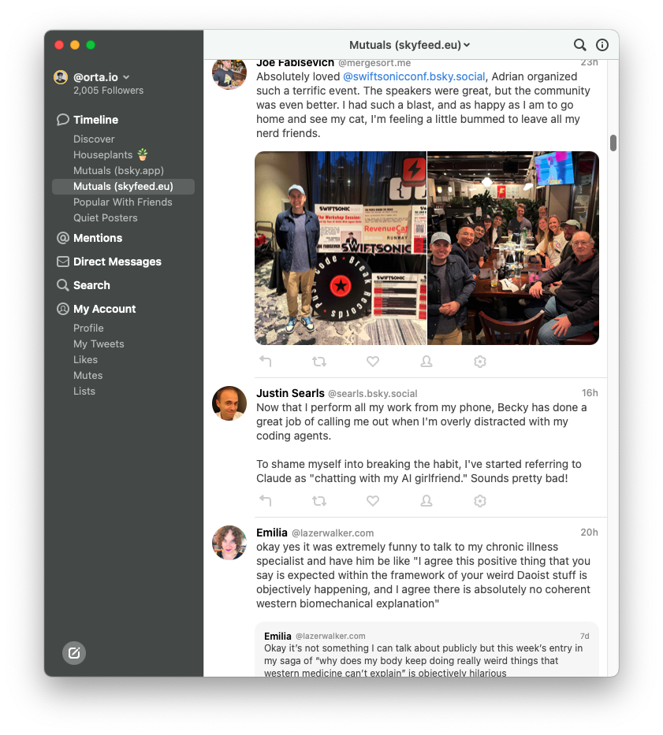

# atbot — Bluesky in Tweetbot

**atbot** turns a copy of the discontinued Mac App Store app **Tweetbot 3.5.8** into a
native **Bluesky / atproto** client — without rebuilding it. It injects a small dylib
into your own copy of Tweetbot, intercepts the (now-dead) Twitter API traffic, and
answers it with Twitter-shaped JSON backed by atproto. The result is your real Bluesky
timeline, profiles, and mentions rendering in Tweetbot's original native UI.

> Tweetbot's servers are gone and its Twitter OAuth is dead, so the app is otherwise a
> brick. atbot brings it back to life pointed at Bluesky instead.



## Status

Working today (verified end-to-end against a real account on a custom PDS):

- ✅ Binary injection into Tweetbot's Mach-O, anti-tamper neutralized, re-signed to launch
- ✅ **One-click account add, entirely in-app** — no browser round-trip, no manual steps;
  the account **persists** across restarts and auto-reauthorizes on launch
- ✅ **Reads** — home / mentions / user timelines and profiles render with correct links,
  cleaned `display_url`s, `@mentions`, hashtags, and photos
- ✅ **Bluesky feeds + lists in the timeline dropdown** — your saved/pinned feeds (Discover,
  Mutuals, …) and lists appear as Tweetbot "lists"; click the **Timeline** title to switch
- ✅ **Writes** — post (with link/mention facets), like, repost, follow, delete, all creating
  real atproto records; replies thread correctly
- ✅ **Web permalinks** — Copy Link / Open in Browser point at `bsky.app`
- ✅ **In-process bridge** — the whole translation layer runs inside the app (no Node,
  no external server, no open port you manage). A built `atbot.app` is self-contained.
- ✅ Credentials baked in at build time (`Contents/Resources/atproto.json`)
- ✅ **Dependency-free native builder** — a "Make atbot" Mac app transforms your installed
  Tweetbot with nothing but macOS (no Xcode / Python / Node / LIEF needed by the end user)

Not done yet:

- 💬 DMs, search result quality, media upload
- 🔔 Notifications beyond mentions / replies

## How it works

Tweetbot hardcodes `https://api.twitter.com/...` and routes OAuth + REST through
`push.tapbots.com`. atbot is a **loopback bridge**, not UI surgery:

1. **Injected dylib** (`inject/redirect.m`) swizzles `NSURLSession`'s task-creation
   methods and rewrites every request aimed at `*.twitter.com` / `push.tapbots.com` to a
   local HTTP server on `127.0.0.1`.
2. **In-process bridge** (`inject/bridge.m`) *is* that server — it runs inside the app,
   emulates the Twitter 1.1 endpoints Tweetbot calls, and answers them with Twitter-shaped
   JSON translated from atproto XRPC (`app.bsky.*`) calls to your PDS.
3. **OAuth completes in-process** — the dylib intercepts the authorize step and delivers
   the callback straight back through atbot's own `atbot://` URL scheme, so "Add Account"
   finishes with one click and no browser. (It still reproduces Tapbots' multipart proxy
   protocol and the uuid-keyed callback the app expects.)

The app never knows it's talking to Bluesky.

See [CLAUDE.md](CLAUDE.md) for the full technical story, including the reverse-engineering
notes (anti-tamper bypass, the OAuth uuid-correlation fix, the CloudKit crash fix).

## Using it: the "Make atbot" app

The simplest path. You need a legitimately-installed **Tweetbot 3.5.8** at
`/Applications/Tweetbot.app` (from your Mac App Store purchase — atbot transforms *your*
copy and never redistributes Tapbots' binary) and nothing else: **no Xcode, no Python, no
Node**. Grab `Atbotify.app` from the release, open it, point it at Tweetbot, enter your
Bluesky handle + app password, and click **Create atbot…**. It writes a new `atbot.app`
and launches it.

> Use a **Bluesky app password** (bsky.app → Settings → App Passwords), never your main
> password — it's scoped and revocable. On a custom PDS, leave the PDS field blank and
> atbot resolves it from your DID document, or fill it in explicitly.

The builder runs the whole transform natively — anti-tamper patch, `LC_LOAD_DYLIB`
injection, ad-hoc re-sign — using only `ditto` and `codesign`, which ship with macOS.
Locally-built apps carry no quarantine flag, so the ad-hoc `atbot.app` launches without a
Gatekeeper prompt. Release builds of `Atbotify.app` itself are Developer ID-signed and
notarized.

## Building from source

Maintainer path — needs Xcode command-line tools (`clang` + `swiftc`) and Node (for the
build scripts):

```sh
# build atbot.app into ./build, with the in-process bridge compiled in (no LIEF/Python)
bash scripts/build-and-inject.sh

# bake in your Bluesky credentials
cat > build/atbot.app/Contents/Resources/atproto.json <<'JSON'
{ "handle": "you.bsky.social", "appPassword": "xxxx-xxxx-xxxx-xxxx", "pds": "https://bsky.social" }
JSON
codesign --force -s - --entitlements scripts/modded.entitlements.plist build/atbot.app
open build/atbot.app

# ...or build the distributable Make atbot app into ./dist
bash builder/package.sh
```

Releases are cut by pushing a `v*` tag: CI signs, notarizes and publishes `Atbotify.app` to
GitHub Releases. See [docs/RELEASING.md](docs/RELEASING.md).

The dylib injects into `PTHCommon.framework` (which has ample header padding, unlike the
main executable) as a simple in-place edit — so the pipeline needs no LIEF/Python.

### Developing the bridge without rebuilding the app

The bridge logic also exists as a dependency-free Node prototype under `bridge/`, handy
for iterating on the translation layer:

```sh
BRIDGE_HANDLE=you.bsky.social BRIDGE_APP_PASSWORD=xxxx-xxxx-xxxx-xxxx \
  BRIDGE_PDS=https://bsky.social node bridge/server.mjs
# then build atbot with TWEETBOT_BRIDGE_PORT=8080 so the dylib uses the external server
```

## Legal

This is a personal-use interoperability mod of software you already own. It modifies your own
copy of Tweetbot and does not redistribute Tapbots' code. Note that neutralizing the Mac App
Store receipt check (required to run a re-signed copy) touches DMCA §1201, and "atbot" /
Tweetbot branding is Tapbots' trademark — so a widely-distributed build carries real legal
exposure that a personal tool does not. Not legal advice; if you ship it publicly, talk to a
lawyer. This project is not affiliated with Tapbots or Bluesky.
